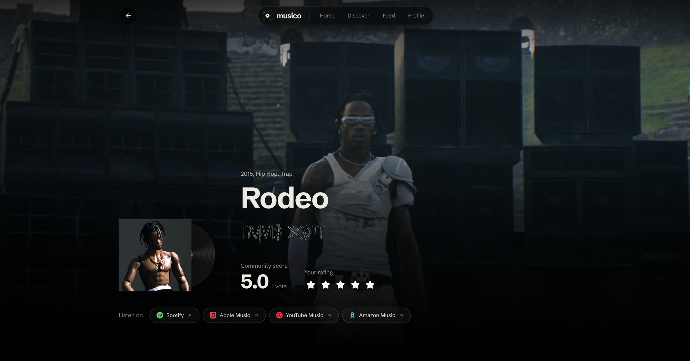

<div align="center">


# Musico

**Letterboxd, but for albums.**

Rate the records you love, write about the ones that stayed with you,<br />
and see what your friends are listening to.

[**Try it live**](https://musico-web.vercel.app) · [Report a bug](https://github.com/moKshagna-p/musico/issues) · [Contribute](#contributing)

<br />



</div>

---

## Why Musico?

I've been a Letterboxd fan for years. Logging films, writing short reviews, scrolling through friends' diaries: it turns watching into something you share. I kept wishing music had the same thing, so I built it.

Musico is free, open source, and made for people who still listen to albums from start to finish.

## What you can do

- **Rate albums** in half stars, from 0.5 to 5
- **Write reviews** and add images or GIFs when words aren't enough
- **Keep a Listen Later list**, your watchlist for records
- **Make your own lists** and share them with a public link
- **Follow friends** and see their ratings and reviews in your feed
- **Look back at your listening diary** and rating history on your profile
- **Discover new music** through trending releases, search, and artist pages

All album data comes from [Discogs](https://www.discogs.com), so nearly any record you can think of is already there.

## Built with

| Layer | Stack |
| :--- | :--- |
| Frontend | React, Vite, TailwindCSS, TanStack Query, Framer Motion |
| Backend | Bun, Elysia, Better Auth |
| Data | PostgreSQL (Neon), Drizzle ORM |
| Hosting | Vercel (web), Cloudflare Workers (API) |
| Tooling | Turbo, mprocs, Vitest, Playwright |

The repo is a Turbo monorepo with two apps:

```
apps/
  web/   React frontend
  api/   Elysia API that wraps Discogs, with Postgres and in-memory caching
```

The API caches Discogs responses in Postgres and in memory, so pages load quickly and the upstream API isn't hit more than it needs to be.

## Run it locally

You'll need **Bun 1.3.10+**, **Node.js 22+**, and a **PostgreSQL** database (a free [Neon](https://neon.tech) one works well).

```bash
git clone https://github.com/moKshagna-p/musico.git
cd musico
bun install
cp .env.example .env   # fill in DATABASE_URL, DISCOGS_TOKEN, BETTER_AUTH_SECRET
bun run db:migrate:api
bun run dev
```

`bun run dev` starts the web app at http://localhost:5173 and the API at http://localhost:4000 in separate mprocs panes.

### Checks

```bash
bun run lint        # lint every workspace
bun run test        # API and web unit tests
bun run test:e2e    # Playwright end-to-end tests
```

## Contributing

Contributions of any size are welcome, from a typo fix to a whole feature.

1. Fork the repo and create a branch
2. Make your change, and add tests if it touches logic
3. Run `bun run lint` and `bun run test`
4. Open a pull request

If you're not sure where to start, open an issue and say hi.

<details>
<summary><strong>Releases and deployment (maintainers)</strong></summary>

<br />

Pushes and pull requests only run CI. Production deploys run from the `Release` workflow when a `v*` tag is pushed or when the workflow is started manually. Each release publishes a short summary of the commits since the previous tag.

The deploy jobs target the `production` GitHub Actions environment and need these secrets:

```sh
gh secret set CLOUDFLARE_API_TOKEN --env production
gh secret set CLOUDFLARE_ACCOUNT_ID --env production
gh secret set VERCEL_TOKEN --env production
gh secret set VERCEL_ORG_ID --env production
gh secret set VERCEL_PROJECT_ID --env production
```

If any of them are missing, the workflow fails before it tries to deploy.

</details>

<details>
<summary><strong>Production security (maintainers)</strong></summary>

<br />

- Create the first admin with the operator-only command in [`apps/api/CLOUDFLARE.md`](apps/api/CLOUDFLARE.md). Admin access at runtime is granted only through the `admin_user` table.
- Set a dedicated, high-entropy `CRON_SECRET`. Cron refresh endpoints accept only `POST` requests with `Authorization: Bearer <CRON_SECRET>`.
- Add Cloudflare WAF and rate-limiting rules for `/api/auth/*`, `/api/search`, and `/api/releases/*`. The Worker's built-in limiter is a local fallback, not global DDoS protection.

</details>

## License

[AGPL-3.0](LICENSE). Use it, change it, build on it. If you share or host a modified version, publish your source under the same license.

---

<div align="center">

Made with love for people who listen to the whole album.

</div>
